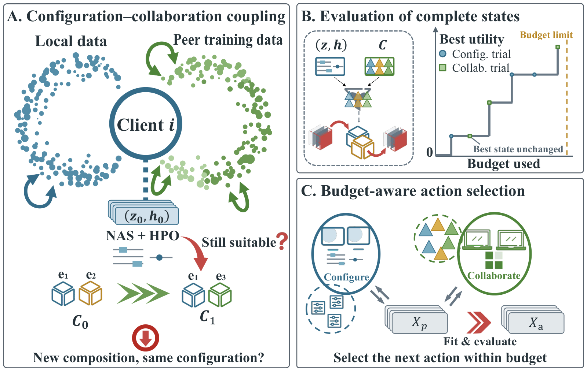

# CIRA

**Coupled Adapter Configuration and Composition for Continual Detector Adaptation**

Composition-Informed Receiver Adaptation (CIRA) is a PyTorch implementation for supervised domain-incremental object detection at decentralized edge nodes. Within an adaptation stage, local configuration revisions and peer membership revisions can build on each other's evaluated detector states. A ridge model estimates the gain of each trial over its parent to guide trial selection under a shared resource budget.



## Installation and configuration

From the repository root, install the package with Python 3.12 and PyTorch. Add the YOLO and plotting extras for detector runs and analysis.

```bash
python -m pip install -e ".[yolo,plots]"
python -m softcas.paper_cli export --output runs/configs
python -m softcas.paper_cli matrix --blocks primary BDD --output runs/matrix.json
```

The [detector workflow](docs/workflow.md) covers dataset preparation, development selection, binding local checkpoints and device settings, and launching a node. The repository includes configurations for ACDC, ControlledFog and BDD100K, and detector profiles for YOLOv8n, YOLO11n and YOLO26n.

## Experiment reproduction

The [experiment guide](docs/experiments.md) covers the paired receiver study, the time-budget model, the BDD100K revisit extension and the scripts for recomputing results and rebuilding Supplementary Figures S2 and S3.

## Reduced feature model

The reduced feature model runs on generated features. Its outputs report feature-model scores.

```bash
python studies/run.py feature --case-id CL-HYP-00001 --output runs/feature
```

## Tests

```bash
python -m unittest discover -s tests -q
```

The tests check state inheritance, resource accounting, runtime interfaces and reporting. The detector and plotting tests use the `yolo` and `plots` extras.

| Directory | Contents |
| --- | --- |
| [`softcas/`](softcas/) | Adapter revisions, state archive, trial selection, runtime and baselines |
| [`configs/`](configs/) | Detector, experiment and device configuration templates |
| [`studies/`](studies/) | Reduced feature model and numerical scenario generators |
| [`analysis/`](analysis/) | Analysis and plotting of bound experiment outputs |
| [`tests/`](tests/) | Unit and integration tests |
